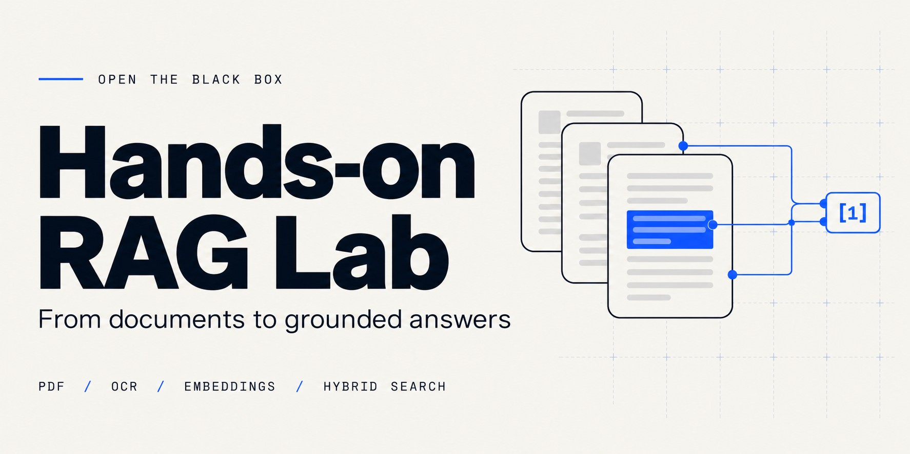

# Hands-on RAG Lab

**Explore your PDFs, retrieve evidence and understand how a RAG answer is built.**

[Live application](https://hands-on-rag-lab.vercel.app) · [RAG theory](https://hands-on-rag-lab.vercel.app/theory) · [Architecture](https://hands-on-rag-lab.vercel.app/architecture) · [Français](README.md)


## What it does

- Read text PDFs or run local French/English OCR with PDF.js and Tesseract.
- Split pages into passages and compute actual 384-dimensional multilingual E5 embeddings in the browser.
- Retrieve with cosine similarity and BM25; merge ranks with RRF and inspect the selected context.
- Show extracted text, vectors, scores, source files/pages and selection rules.
- After explicit consent, ask NVIDIA `openai/gpt-oss-20b` to write an answer from selected excerpts. Verify its citations against the original passages.

The bilingual React/TypeScript interface uses shadcn/ui, an interactive processing workshop, a worked RAG example and inspectable formulas.

## Data and boundaries

Full PDFs and vectors remain in browser session memory. Indexing and retrieval never call NVIDIA. Model weights are downloaded from a pinned Hugging Face revision; PDFs are not sent to Hugging Face.

Generation sends the question, language and selected passages with file/page references through a Vercel Node function. The NVIDIA key stays on the server. Reloading or resetting clears the document session.

Import bounds: **5 MB total, 10 files, 40 pages**. Context selection: **up to 4 passages, 1,600 E5 tokens, cosine ≥0.78**. There is no application request-count quota; provider terms and limits are separate. A citation or similarity score is not proof that an answer is correct.

## Run locally

Requirements: Node.js **24.19+ on the 24.x line**, npm **11.9**. Python 3.12 is used by verification tools.

```bash
git clone https://github.com/Omaroid/hands-on-rag-lab.git
cd hands-on-rag-lab
npm ci --ignore-scripts
npm ci --ignore-scripts --prefix frontend
npm run dev --prefix frontend
```

Open the URL printed by Vite. Local PDF reading, OCR, indexing, retrieval and learning pages need no provider key. The first encoder load downloads about 118 MB of weights plus the tokenizer.

Vite alone does not provide the NVIDIA API. Generation requires the Vercel server functions and their server-side configuration.

## Verify

```bash
npm run test:server
npm run build --prefix frontend
python3 scripts/check_bundle.py
npm exec --prefix frontend -- playwright install chromium
python3 scripts/verify_pdf.py --skip-build
```

The browser suite uses actual PDF extraction, OCR and checksum-verified E5 inference on desktop/mobile emulation. **Generation UI cases are mocked; CI has no production credentials and makes no live provider calls.** Real NVIDIA checks are recorded separately in the [deployment checks](DEPLOYMENT.md).

See [CONTRIBUTING.md](CONTRIBUTING.md) for maintenance tools and the full development workflow.

## GitHub → Vercel

The existing Vercel project is linked to this GitHub repository; `main` is the production branch. [vercel.json](vercel.json) runs the Node API tests before the PDF frontend build and serves `frontend/dist` plus `api/ai/*`.

Configure only in **Vercel / Production**:

- `NVIDIA_API_KEY`: sensitive server variable, entered directly in Vercel.
- `RAG_PUBLIC_GENERATION=true`: explicit server-side activation flag.

Never prefix a secret with `VITE_`, commit it or place it in a chat. Without the server configuration, retrieval still works and generation stays unavailable. GitHub Actions needs no NVIDIA or Vercel deployment token: CD uses the native Git integration.

```bash
python3 scripts/check_public.py --expect-generation-ready --compare-dist
```

This checks public routes, security headers, favicon, API readiness and optionally build hashes, without calling NVIDIA.

## Project map

| Path | Responsibility |
| --- | --- |
| `frontend/src/PdfApp.tsx` | Public PDF workspace orchestration |
| `frontend/src/pdf-labels.ts` | French/English workspace copy |
| `frontend/src/semantic.worker.ts` | Actual E5 tokenization and inference |
| `frontend/src/pdf-retrieval.ts` | BM25, cosine, RRF and context selection |
| `frontend/src/components/ui` | Maintained shadcn/ui component source |
| `server`, `api/ai` | Validated Node generation boundary |
| `scripts`, `tests`, `frontend/tests` | Reproducible checks and test fixtures |

Read the [security policy](SECURITY.md), [deployment guide](DEPLOYMENT.md), [PDF architecture](docs/PDF_RAG.md) and [third-party notices](frontend/notices/THIRD_PARTY.md). Audits detect known patterns and advisories; they do not provide an absolute security guarantee. Never attach a private PDF or credential to an issue.
