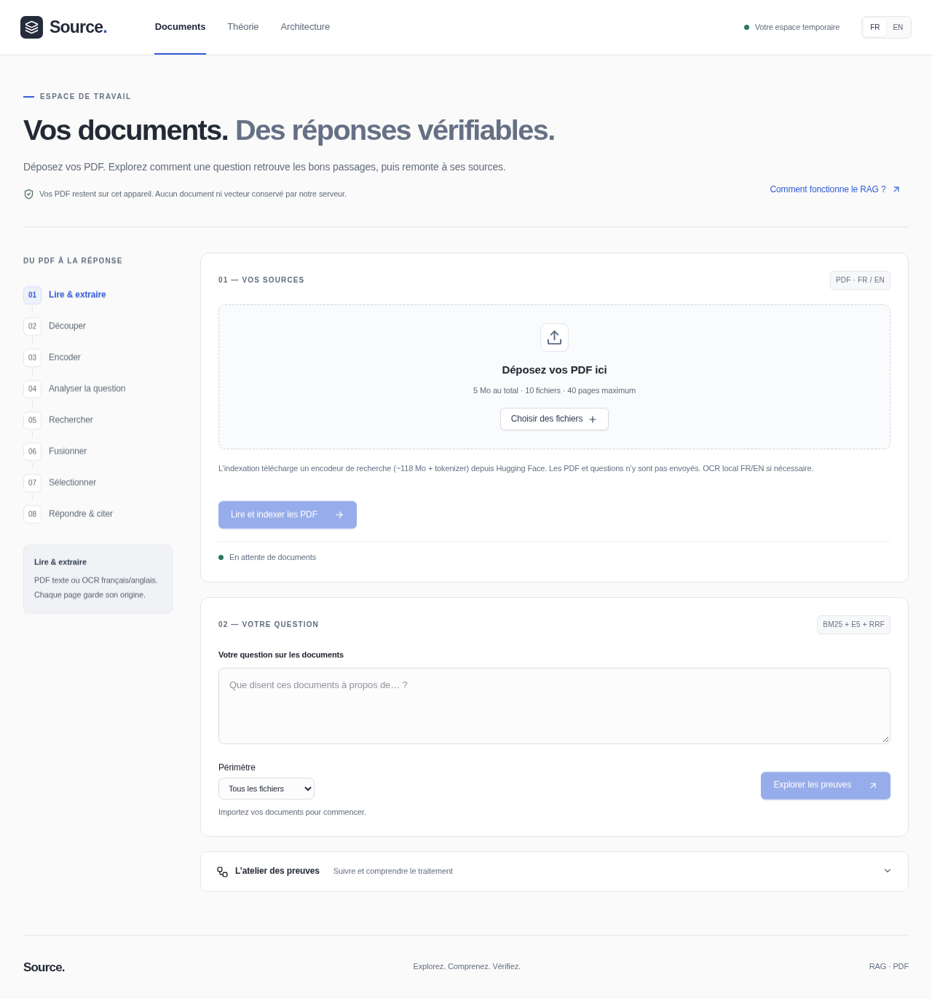
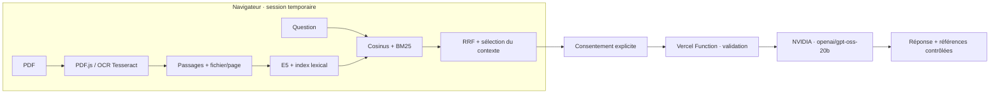

# Source · Lakehouse RAG Lab

**Un laboratoire RAG pour interroger ses PDF et comprendre chaque étape de la réponse.**

[](https://github.com/Omaroid/lakehouse-rag-lab/actions/workflows/ci.yml)

[Application](https://lakehouse-rag-lab.vercel.app) · [Théorie FR/EN](https://lakehouse-rag-lab.vercel.app/theory) · [Architecture et calculs](https://lakehouse-rag-lab.vercel.app/architecture) · [English](README.en.md)



## Ce que fait l’application

1. **Importer** des PDF texte ou scannés. PDF.js extrait le texte ; Tesseract effectue l’OCR français/anglais si nécessaire.
2. **Indexer localement** les passages avec le véritable encodeur multilingue E5, puis conserver leurs vecteurs en mémoire de session.
3. **Rechercher** avec deux méthodes : proximité sémantique par cosinus et correspondance lexicale BM25. RRF fusionne les classements.
4. **Vérifier les preuves** : passages, fichier, page, scores, règles de sélection et budget de contexte restent inspectables.
5. **Générer sur demande** : après consentement, le serveur transmet la question et les seuls passages sélectionnés à NVIDIA GPT-OSS. La réponse contient des références consultables.

L’interface FR/EN comprend un atelier interactif, une page de théorie avec un exemple guidé et une page d’architecture avec les calculs réels de la dernière recherche. Elle utilise **React, TypeScript et shadcn/ui** et respecte la réduction des animations.

> Ce dépôt contient aussi un **laboratoire Python Lakehouse historique**. Il est indépendant du parcours PDF publié sur Vercel. Son guide est dans [docs/LEGACY_LAB.md](docs/LEGACY_LAB.md).

## Architecture et circulation des données



| Couche | Technologies | Rôle |
| --- | --- | --- |
| Interface | React 19, TypeScript, shadcn/ui, Radix UI, Tailwind 4, Vite | Écrans, interactions accessibles, visualisation des étapes |
| Lecture | PDF.js, Tesseract.js, Web Workers | Extraction et OCR locaux, interface réactive |
| Encodage | Transformers.js, ONNX Runtime, multilingual E5 small | Vecteurs de 384 dimensions, pooling moyen et normalisation L2 |
| Recherche | BM25, cosinus, Reciprocal Rank Fusion | Recherche hybride et classement observable |
| API | Fonctions Node.js Vercel | Consentement, validation, appel fournisseur et contrôle des citations |
| Génération | API NVIDIA, GPT-OSS 20B | Rédaction à partir des passages fournis |

Les poids E5 sont téléchargés depuis Hugging Face à une révision fixée. Les fichiers du modèle utilisés en test sont vérifiés par SHA-256 : [manifeste](evidence/pdf-model-manifest.json).

### Confidentialité et limites

- Les **PDF complets et les vecteurs restent dans le navigateur**. Ils ne sont pas enregistrés par l’API. La session est perdue au rechargement ou à la réinitialisation.
- La recherche et l’indexation n’appellent pas NVIDIA. La génération envoie, après accord, la question, la langue et les passages choisis avec leur fichier/page.
- La clé NVIDIA reste une variable serveur sensible. Aucun secret n’est nécessaire au build de l’interface ou aux tests CI.
- Import : **5 Mo cumulés, 10 fichiers et 40 pages**. Sélection : **4 passages maximum, 1 600 tokens E5, cosinus ≥ 0,78**. [Détails des bornes](docs/PDF_RAG.md).
- **Aucun quota applicatif de demandes** n’est ajouté. Les conditions et limites des fournisseurs restent distinctes ; ce projet ne promet pas un service NVIDIA illimité.
- Une citation et un score ne prouvent pas qu’une réponse est correcte. Relisez les passages ; le seuil de pertinence est heuristique.

## Démarrer en local

Prérequis : **Node.js 24.19+ dans la branche 24**, **npm 11.9**. Python 3.12 est utile pour les outils de vérification, mais n’est pas requis pour ouvrir l’interface.

```bash
git clone https://github.com/Omaroid/lakehouse-rag-lab.git
cd lakehouse-rag-lab
npm ci --ignore-scripts
npm ci --ignore-scripts --prefix frontend
VITE_RUNTIME=browser npm run dev --prefix frontend
```

Ouvrir l’URL affichée par Vite. L’import, l’OCR, l’indexation, la recherche et les pages pédagogiques fonctionnent sans clé fournisseur. Le premier encodage télécharge environ **118 Mo de poids**, plus le tokenizer.

**La génération locale nécessite les fonctions serveur Vercel et leur configuration.** Le serveur de développement Vite seul ne fournit pas l’API NVIDIA ; cela n’empêche pas la recherche locale. Le backend Python historique n’est pas le serveur de génération des PDF.

### Construire et vérifier

```bash
npm run test:server
VITE_RUNTIME=browser npm run build --prefix frontend
python3 scripts/check_bundle.py
npm exec --prefix frontend -- playwright install chromium
python3 scripts/verify_pdf.py --skip-build
```

Le dernier outil démarre et arrête son propre serveur local. Il teste réellement les PDF, l’OCR et E5 sur ordinateur et mobile émulé. Le modèle est téléchargé dans `work/e5`, ignoré par Git. **Les cas d’interface de génération sont simulés : la CI n’appelle aucun fournisseur et n’a aucun secret de production.** Les vérifications réelles NVIDIA sont documentées séparément dans les [preuves de publication](evidence/generation-publication-current.json).

Pour les contrôles Python historiques et les commandes complètes : [CONTRIBUTING.md](CONTRIBUTING.md).

## Déployer sur Vercel

Le projet existant `lakehouse-rag-lab` est relié au dépôt GitHub ; **`main` est la branche de production**. La configuration versionnée est dans [vercel.json](vercel.json).

| Réglage | Valeur |
| --- | --- |
| Racine du projet | Racine du dépôt |
| Runtime | Node.js 24 |
| Installation | `npm ci --ignore-scripts && npm ci --ignore-scripts --prefix frontend` |
| Build | `npm run test:server && VITE_RUNTIME=browser npm run build --prefix frontend` |
| Fichiers statiques | `frontend/dist` |
| Fonctions | `api/ai/answer.js`, `api/ai/status.js` |

Variables à configurer **uniquement côté serveur dans Vercel / Production** :

| Variable | Type / rôle |
| --- | --- |
| `NVIDIA_API_KEY` | Sensible ; clé fournie directement dans Vercel, jamais dans Git ou le chat |
| `RAG_PUBLIC_GENERATION` | `true` pour activer explicitement la génération |

Ne jamais utiliser de préfixe `VITE_` pour une clé. Sans ces réglages, la recherche fonctionne et la génération reste indisponible. Aucun token Vercel ou NVIDIA n’est nécessaire dans GitHub Actions : le déploiement passe par l’intégration Git native.

```bash
python3 scripts/check_public.py --expect-generation-ready --compare-dist
```

Ce contrôle public vérifie les routes, les en-têtes de sécurité, le favicon, le statut de l’API et, sur demande, les empreintes du build. Il ne lance aucun appel NVIDIA. Voir [DEPLOYMENT.md](DEPLOYMENT.md) pour le flux CI/CD et le retour arrière.

## Qualité et sécurité

La CI couvre l’historique Git avec Gitleaks, les fichiers suivis avec secretlint, les audits npm/Python, les tests de l’API Node, les builds, les tests navigateur réels et le laboratoire Python. Les actions sont fixées par commit ; les installations npm désactivent les scripts de dépendances ; les permissions GitHub sont en lecture seule.

- [Contrôles de préparation à la publication](evidence/public-release-readiness.json)
- [Politique de sécurité et signalement](SECURITY.md)
- [Contribuer et lancer les vérifications](CONTRIBUTING.md)
- [Architecture détaillée du parcours PDF](docs/PDF_RAG.md)
- [Génération et historique de ses contrôles](docs/PDF_GENERATION.md)
- [Laboratoire Python optionnel](docs/LEGACY_LAB.md)
- [Licences et attributions des composants tiers](frontend/notices/THIRD_PARTY.md)

Les audits détectent des signatures et vulnérabilités connues ; ils ne constituent pas une garantie absolue. Ne joignez jamais de clé, PDF privé ou capture sensible à une issue.
