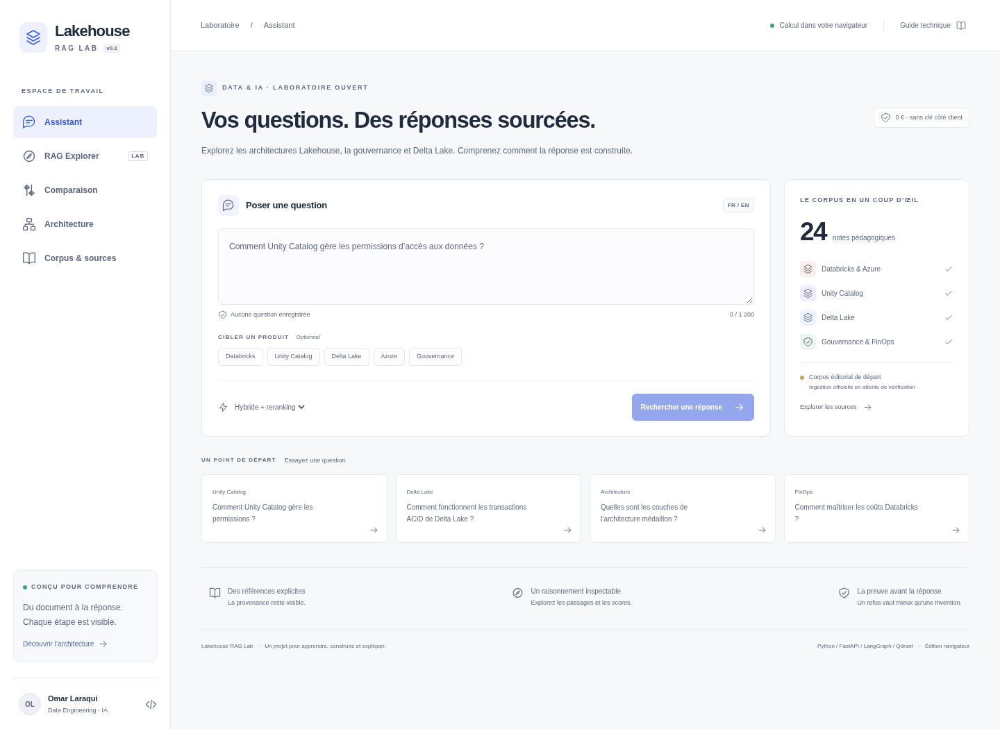
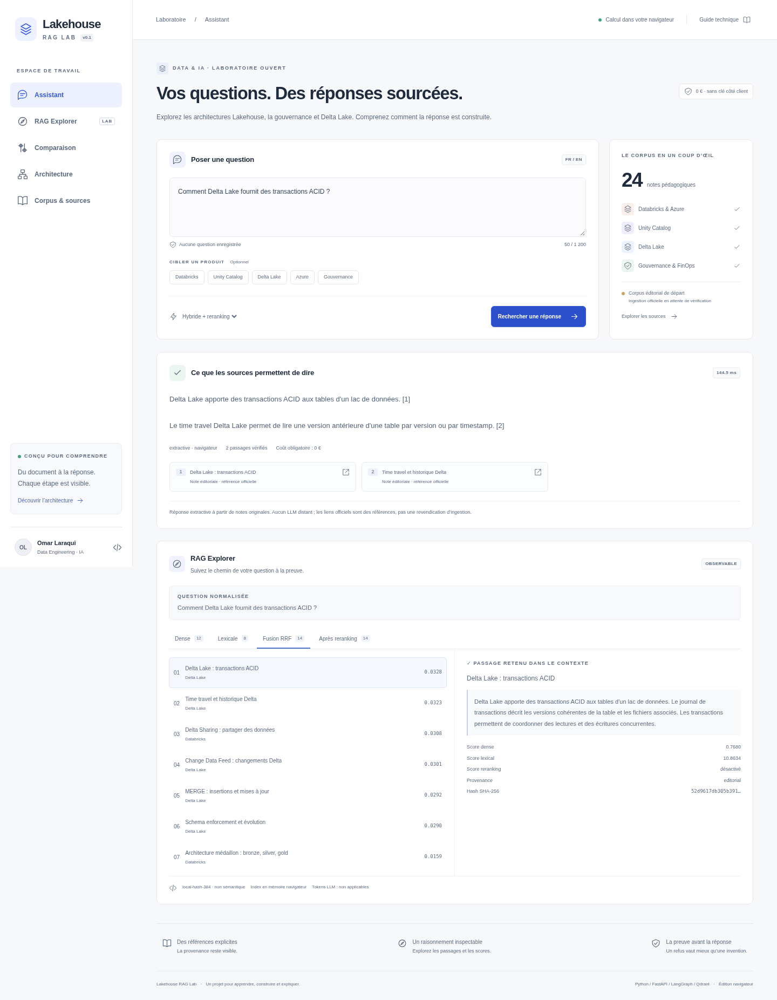
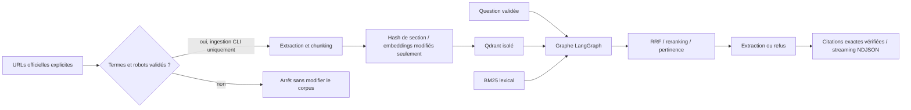

# Source — comprendre le RAG sur ses propres PDF

La vitrine navigateur est maintenant un espace temporaire bilingue FR/EN : import de PDF
(5 Mo cumulés), extraction ou OCR local, passages bornés par le tokenizer, embeddings E5
multilingues, BM25 et fusion RRF inspectables, citations avec fichier et page.
Les PDF complets et vecteurs restent locaux. La génération NVIDIA côté serveur est
**activée**, après consentement pour l'envoi de la question et des passages sélectionnés,
sans plafond applicatif de demandes. La page [Architecture](https://lakehouse-rag-lab.vercel.app/architecture) expose le parcours, les formules et les calculs de votre dernière recherche. Les réponses citées ont été réellement validées
sur PDF texte et scan OCR. Voir [PDF_GENERATION.md](docs/PDF_GENERATION.md),
[PDF_RAG.md](docs/PDF_RAG.md) et [RESUME.md](docs/RESUME.md) pour preuves et limites.

L’atelier des preuves accompagne l’indexation : pages réellement lues, cartes de texte,
vecteurs calculés, recherche à deux voies et panier de passages. Chaque étape est
cliquable, avec des exemples tirés des PDF en session et un petit défi pédagogique.
Aucune progression n’est simulée et aucun appel NVIDIA n’est lancé pendant l’indexation.

Build : `VITE_RUNTIME=browser npm run build --prefix frontend`.
Les dépendances sont verrouillées ; les assets OCR/WASM sont préparés au build.
Les fonctionnalités historiques Lakehouse restent décrites ci-dessous.

---

# Lakehouse RAG Lab

Un laboratoire observable consacré aux architectures Lakehouse : recherche, inspection des preuves,
comparaison des stratégies et réponses extractives citées. Python/FastAPI, LangGraph, Qdrant,
React/TypeScript, MCP, évaluations MLflow locales et Docker.

> **État réel : recherche multilingue et corpus officiel Delta Lake intégrés.**
> Le backend peut utiliser MiniLM ONNX sur CPU et 20 documents officiels Apache-2.0
> (1 034 passages) dans le cluster Qdrant Free dédié. Les notes pédagogiques et le hash lexical
> restent le baseline et le compagnon public. Les réponses sont extractives, sans appel LLM.
> L'API publique serverless reste fermée tant que les quotas durables gratuits ne sont pas raccordés.
> Voir [STATUS.md](STATUS.md) pour les vérifications et les limites.

## Backend sémantique vérifié

Depuis la racine, après installation du groupe `semantic` et préparation des fichiers du modèle
à la révision fixée (voir [le guide embeddings](docs/learning/01-embeddings.md)) :

```bash
.venv/bin/python scripts/serve_semantic.py \
  --corpus corpus/delta-official-semantic.json \
  --model-dir work/models/multilingual-minilm --cloud --build
```

Ouvrir `http://localhost:8000`. La clé Qdrant de lecture reste dans l'environnement ; la clé
d'écriture est retirée du processus de service. Sans `--cloud`, la même commande utilise
Qdrant en mémoire local, sans contacter le cluster. Le frontend affiche le corpus et la
provenance réellement servis. Il faut un hôte local durable pour les quotas SQLite.
La commande vérifie les tokens et le nombre de points avant de servir.

[Manifeste des 20 sources](evidence/delta-source-manifest.json),
[licence et attribution](corpus/licenses/delta/),
[vérification cloud FR/EN](evidence/cloud-semantic-integration.json).

## Démonstration

**[Ouvrir la démonstration publique](https://lakehouse-rag-lab.vercel.app)** — édition navigateur.
Les détails de vérification sont dans [DEPLOYMENT.md](DEPLOYMENT.md).
Essayez « Comment Delta Lake fournit des transactions ACID ? », inspectez les résultats fusionnés,
puis « Quelle est la météo à Paris ? » pour observer un refus.





## Architecture



L'édition navigateur est un compagnon statique : le même principe de recherche et de fusion,
un index JavaScript en mémoire, aucun serveur d'inférence. Elle ne prétend pas utiliser Qdrant
ou LangGraph dans le navigateur. [ARCHITECTURE.md](ARCHITECTURE.md) détaille les deux exécutions.

## Fonctionnalités

- Questions FR/EN, filtres par produit, quatre stratégies de recherche réellement calculées.
- Explorer : question normalisée, chunks, scores dense/lexical/RRF, rang après reranking et contexte.
- Citations avec provenance, refus si le contexte n'est pas suffisamment pertinent.
- Backend typé, neuf nœuds LangGraph, Qdrant local réel et client cloud en lecture seule.
- Ingestion CLI avec liste blanche HTTPS, robots, revue des termes, taille bornée, hash incrémental.
- Trois outils MCP locaux en lecture seule, sans fetch arbitraire ni exécution de code.

## Lancement local

Python 3.12, Node 24 et uv 0.12.23. Aucune clé distante n'est nécessaire.

```bash
uv sync --frozen --group evaluation
npm ci --prefix frontend
npm run build --prefix frontend
uv run python -m lakehouse.baseline
uv run uvicorn app:app --host 127.0.0.1 --port 8000 --no-access-log --no-proxy-headers
```

Ouvrir `http://localhost:8000`. Le mode par défaut utilise Qdrant embarqué en mémoire ; aucune
ressource cloud n'est créée. Pour développer avec rechargement, lancer `npm run dev --prefix frontend`
à côté du backend. Le proxy Vite envoie `/api` au backend ; garder l'origine API configurée
cohérente si le navigateur envoie un en-tête Origin.

Docker avec Qdrant serveur, indexation et volume de quotas :

```bash
python -c 'import secrets; print("ANONYMIZATION_SECRET="+secrets.token_hex(32))' > .env
docker compose up --build
```

Ce fichier `.env` est ignoré par Git. Ne jamais partager sa valeur. Le port Qdrant est publié
uniquement sur la boucle locale. Arrêter avec `docker compose down` ; ajouter `-v` uniquement
si vous voulez détruire les volumes de développement.

## Vérifications reproductibles

```bash
uv run ruff format --check backend tests scripts app.py
uv run ruff check backend tests scripts app.py
uv run mypy backend
uv run pytest -q
uv run python scripts/check_schema.py
MLFLOW_ALLOW_FILE_STORE=true uv run --group evaluation python scripts/evaluate.py --mlflow
uv run pip-audit
npm audit --prefix frontend
VITE_RUNTIME=browser npm run build --prefix frontend
uv run python scripts/check_bundle.py
# Vérifier les deux runtimes avec serveurs et quotas de test isolés :
(cd frontend && npx playwright install chromium)
uv run --group semantic python scripts/verify_web.py
# Avec Chromium système : préfixer la commande par CHROMIUM_PATH=/usr/bin/chromium
```

La CI versionnée répète ces contrôles, ajoute la détection de secrets et le build Docker.
Le dépôt étant actuellement privé, son job reste désactivé pour éviter toute minute facturable ;
il s'exécute uniquement sur un dépôt public avec runner standard.
Les résultats exécutés ici sont conservés dans [evidence](evidence/), sans déclarer qu'une CI
GitHub a réussi avant son exécution distante. Les tests ne consomment aucun jeton payant. Le lanceur `scripts/verify_web.py` construit puis
vérifie les éditions backend et navigateur, démarre ses propres serveurs locaux et utilise
un compteur de test neuf par exécution. Il retire les accès Qdrant cloud de ses sous-processus
et conserve les protections et quotas de l’application. Ne pas lancer ces tests sur un
serveur de développement déjà utilisé : ses quotas peuvent légitimement être épuisés.

## Mesures

42 cas annotés : 24 factuels, 6 comparaisons/multi-sources, 12 refus/ambiguïtés/injections.
Le rapport mesuré [evaluation.json](evidence/evaluation.json) contient les résultats de chaque cas.
Sur ce jeu éditorial synthétique, hybride : Recall@4 = 0,9833 ; Precision@4 = 0,2833 ; MRR = 0,9611.
Ces chiffres ne constituent pas un benchmark indépendant ni une mesure de fidélité d'un LLM.
Les citations sont vérifiées par correspondance exacte avec les notes, pas par entailment des
pages officielles. Voir [EVALUATION.md](EVALUATION.md).

## Sécurité et coût

Aucun appel payant n'est implémenté dans le chemin actif. Pas de clé dans le navigateur, pas
d'upload public, pas de web search dynamique, pas de HTML LLM injecté, pas de tracker ni cookie
marketing. Le backend impose des limites, des timeouts et des réservations de quota atomiques
sur SQLite. Il refuse les requêtes serverless plutôt que de simuler un plafond global avec
un compteur en mémoire. [SECURITY.md](SECURITY.md) et [COST.md](COST.md) expliquent les limites.

## Apprendre et présenter

Commencer par [LEARNING_GUIDE.md](LEARNING_GUIDE.md), puis suivre les chapitres dans
[docs/learning](docs/learning/). Les choix structurants sont dans [docs/adr](docs/adr/).

Pitch court :

« J’ai construit un RAG observable consacré aux architectures Lakehouse. Le moteur Python/FastAPI
orchestre une recherche hybride, un reranking, un contrôle de pertinence et une validation des
citations. L’application rend les étapes du retrieval visibles afin de comparer les stratégies
et d’expliquer les décisions du système. »

Préciser ensuite en entretien : « La version actuelle est un baseline extractif, avec un index
Qdrant local et un compagnon navigateur à coût nul. Les embeddings neuronaux, le corpus officiel
et le LLM distant sont des étapes distinctes, pas des fonctionnalités simulées. »

## Limites et roadmap

1. Finaliser la revue des conditions et robots, puis ingérer 20–50 pages officielles.
2. Raccorder le cluster Qdrant Cloud Free dédié fourni par le propriétaire ; suivre
   [le guide de configuration](docs/CLOUD_SETUP.md), puis créer un index isolé avec clé read-only.
3. Évaluer de vrais embeddings multilingues, le chunking associé et un reranker éventuel.
4. Vérifier le catalogue AI Gateway, l'éligibilité gratuite du compte, le non-rechargement et
   la coupure fournisseur avant d'implémenter un fournisseur distant.
5. Ajouter un stockage atomique durable gratuit avant toute API publique de génération.
6. Élargir le jeu d'évaluation avec données tenues à part et jugements humains indépendants.

Aucune application existante et aucun projet Supabase ne sont utilisés ou modifiés.
