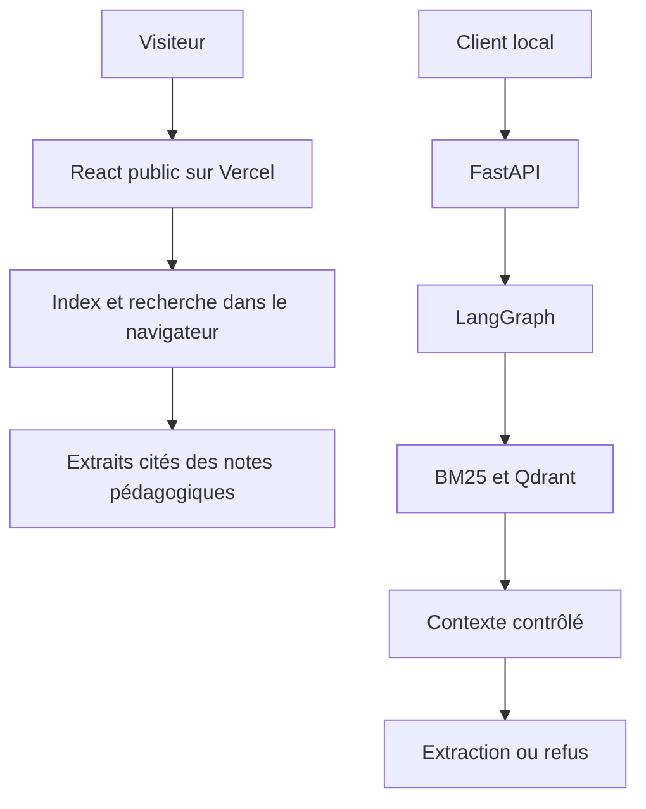
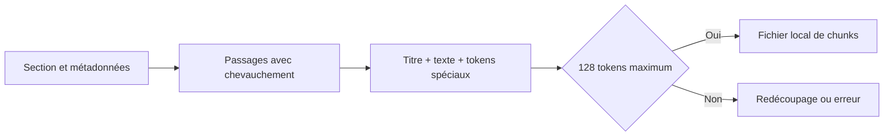
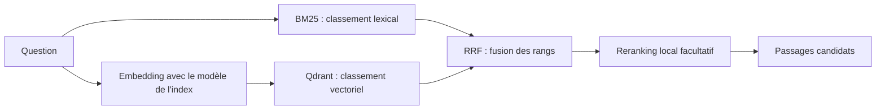

# Visite du projet, composant par composant

Ce chapitre décrit le code actuel. Il sépare les fonctions présentes, les changements récents
et les validations encore nécessaires. Les chapitres suivants approfondissent chaque mécanisme.

## Deux exécutions

Le site public est un compagnon interactif statique. Le backend Python est un autre chemin,
exécuté localement. La publication du premier ne prouve pas que le second fonctionne dans
Vercel. Aucun LLM distant n'est actuellement actif.

## Sources et ingestion — ingestion.py, config/sources.json

Une liste explicite de 22 URLs délimite le corpus candidat. La CLI vérifie l'hôte HTTPS,
la résolution DNS, robots.txt, une revue récente des conditions et la taille téléchargée.
Elle refuse les redirections : les destinations doivent être examinées et enregistrées.
Les scripts de revue ont révélé 19 redirections et une page Delta finale en 404 ; les URLs
configurées ont été corrigées vers des destinations vérifiées HTTP 200.

L'extraction retire scripts, menus et éléments de navigation, puis conserve titres,
paragraphes, listes, code et tableaux. L'instantané du corpus n'est remplacé qu'après la
réussite de toutes les pages. Un échec conserve l'ancien fichier.

Les revues de droits restent pending. Les 24 notes originales ne sont pas des pages officielles
ingérées. Le propriétaire a choisi de reporter la revue des conditions Databricks ; les autres
composants peuvent avancer sans lever cette garde.

## Découpage — chunking.py et semantic_chunking.py

Un document entier serait trop long pour l'embedding et donnerait des citations peu précises.
Le découpage initial suit les sections et estime 650 tokens avec 75 de chevauchement.
Ce sont des paramètres du baseline, incompatibles avec la limite du petit modèle retenu.

La nouvelle CLI `scripts/rechunk_semantic.py` utilise le tokenizer local, compte le titre et
les tokens spéciaux dans les 128 tokens, et propose 16 tokens de chevauchement. Elle conserve
le texte exact et ses métadonnées, génère des IDs déterministes et n'écrase pas l'entrée.
Elle n'infère aucun vecteur et ne contacte aucun service. Les tests vérifient aussi Unicode,
la couverture complète du texte, la stabilité des IDs et la conservation de provenance.

## Embeddings — embeddings.py

Le hash lexical par défaut produit 384 nombres à partir des termes. Il est reproductible et
utile pour apprendre le pipeline, mais ne représente pas un sens appris par un modèle.

Le modèle optionnel `sentence-transformers/paraphrase-multilingual-MiniLM-L12-v2` produit lui
aussi 384 nombres. FastEmbed fournit un port ONNX quantifié, utilisable sur CPU et sous licence
Apache-2.0. La configuration amont du modèle limite les entrées à 128 tokens.

La garde approximative de 380 caractères a été remplacée par un comptage avec le tokenizer
réel, désactivant sa troncature et son padding pour le contrôle. Tout le lot est vérifié avant
inférence. Les tests de cette garde utilisent un tokenizer synthétique ; ils ne prouvent pas
la qualité des poids réels. Le téléchargement de ceux-ci reste bloqué par la politique réseau
observée. Aucun modèle sémantique n'est déclaré actif.

## Qdrant — retrieval.py, cloud_setup.py, index_qdrant.py

Qdrant stocke les vecteurs avec les passages et leurs métadonnées. Une question transformée
avec le même modèle permet de chercher les vecteurs proches par similarité cosinus.
L'indexation est une commande administrative séparée des requêtes publiques.

Le diagnostic officiel reçoit `collection_missing` avec le port HTTPS **443 explicite** :
la collection n'est pas encore créée. Sur 6333, cet environnement recevait 403. Le 404 n'est
pas une preuve de facturation ni une attestation de droits read-only ; ces propriétés restent
à contrôler dans la console. Aucune écriture cloud n'a été faite.

Les nouvelles gardes empêchent de remplir la collection multilingue avec le hash ou le corpus
éditorial, et empêchent le backend de la rechercher avec le hash. Deux espaces de vecteurs
restent incompatibles même lorsqu'ils ont le même nombre de dimensions.

## Recherche hybride — retrieval.py

BM25 classe les passages selon les termes et leur fréquence. La recherche vectorielle classe
selon la proximité des vecteurs ; son intérêt sémantique dépend du modèle réellement utilisé.
Les filtres de produit restreignent les deux recherches.

RRF utilise les rangs plutôt que d'additionner des scores de nature différente. Le reranking
actuel est une heuristique de couverture des termes et du titre, pas un modèle neuronal.
Le mode comparaison permet d'observer les quatre stratégies. Un reranking peut dégrader
le classement ; il doit être évalué.

## Orchestration — graph.py

LangGraph transmet un état entre neuf nœuds : validation, normalisation, recherche, fusion,
reranking, contrôle du contexte, réponse ou refus, vérification des citations et formatage.
La normalisation est déterministe. Les noms des nœuds ne signifient pas qu'un LLM réécrit ou
juge la question. Le contrôle du contexte utilise des règles de correspondance de termes et
exclut les motifs d'injection reconnus ; cette détection n'est pas exhaustive.

## Réponses et citations — generation.py

Le générateur actuel extrait des phrases du contexte. Chaque citation conserve l'identifiant,
l'URL, la provenance et la citation exacte. La validation reconstruit la réponse attendue
à partir des extraits et exige leur présence dans les chunks retrouvés.

Cela établit un support textuel exact dans le corpus. Cela ne démontre pas la vérité du texte,
ni la pertinence complète de la réponse. Une future synthèse LLM nécessitera une évaluation
supplémentaire. Sans contexte suffisant, la chaîne renvoie un refus.

## API et protections — api.py, models.py, quotas.py

FastAPI expose le moteur ; Pydantic valide les types, tailles et valeurs autorisées. Les
protections bornent le corps à 8 192 octets, limitent l'origine, ajoutent les en-têtes de
sécurité et renvoient une erreur sobre en cas de panne. Le streaming NDJSON transmet une
réponse contrôlée ; il ne s'agit pas actuellement d'une génération LLM token par token.

SQLite réserve les quotas de façon atomique : 6/minute et 40/jour par identifiant, 300/jour et
3 000/mois au total. Un HMAC journalier évite de stocker l'IP brute ; l'identifiant reste
pseudonymisé. Les réponses en cache consomment aussi une réservation. Ce stockage convient
à un seul hôte durable ; l'API refuse le serverless tant qu'un compteur durable partagé
n'est pas intégré. Un compteur en RAM par fonction ne protégerait pas un budget global.

## Interface — frontend/src

React/TypeScript fournit questions d'exemple, filtres, citations, comparaison et Explorer.
L'Explorer montre les classements et le contexte pour expliquer les décisions. Le rendu reste
du texte React ; aucun HTML LLM n'est injecté. La version publique utilise son moteur navigateur
et son corpus embarqué. Elle ne doit pas être présentée comme une exécution de LangGraph/Qdrant.

## Évaluation, MLflow et qualité

Le baseline dispose de 42 cas et quatre stratégies évaluées. Les métriques mesurent notamment
Recall@K, Precision@K, MRR, refus, citations et latence. Les runs MLflow sont locaux. Le jeu
éditorial synthétique est proche du corpus ; ses scores ne prouvent pas les performances
sémantiques ni la fidélité d'un futur LLM.

Les derniers tests Python exécutés donnent **54 passed** avec le groupe optionnel semantic
installé et les connexions Qdrant retirées du processus de test. Ruff, mypy et les schémas
passent. Les précédentes preuves frontend et Docker sont conservées, mais ne sont pas des
vérifications fraîchement réexécutées à chaque changement Python.

## Docker, CI/CD, MCP et infrastructure

Docker et Compose décrivent le développement local, avec Qdrant et un backend non-root.
GitHub Actions décrit les contrôles de qualité ; son job reste désactivé sur ce dépôt privé
pour éviter de consommer des minutes facturables non vérifiées. Un workflow versionné n'est
pas un workflow exécuté avec succès.

Le MCP local en stdio expose seulement recherche, réponse et liste des sources. Il ne permet
ni écriture, ni exécution de commande, ni téléchargement arbitraire. Les templates Azure et
Terraform restent documentaires ; aucune ressource d'entreprise n'a été appliquée.

## Coût et prochaines preuves

Le chemin actif n'appelle aucune API d'inférence payante. La disponibilité du catalogue
AI Gateway ne prouve pas l'éligibilité gratuite du compte ou l'existence d'une coupure dure.
Les appels distants restent fermés. Aucun achat, top-up, changement de plan ni nouvelle
ressource facturable n'a été effectué ; coût obligatoire maintenu à 0 €.

Restent à vérifier : réception du domaine de téléchargement dans le runtime, poids et
inférence CPU réels, qualité de recherche FR/EN, droits des sources, indexation officielle,
quotas cloud durables, génération gratuite vérifiée et déploiement backend de bout en bout.
